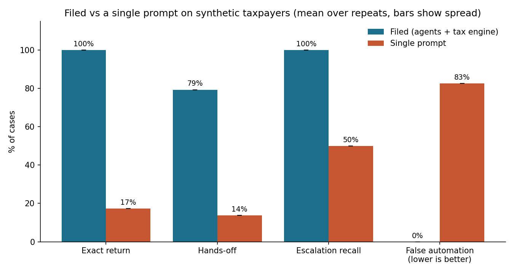

# Filed

**Filed is an agent-run income-tax firm: a salaried person uploads their documents and gets back a checked, filing-ready Indian income-tax return, with a human tax expert involved only on the decisions that need judgment.**

Built for Homingo Hack Days Edition 01, Agents track, statement A2 "The full-stack AI firm".

> Status: built, tested and benchmarked on synthetic data. Every number below comes from saved runs; nothing is estimated.

## The problem

About 7.3 crore income-tax returns are filed in India each year. The documents rarely agree with each other (the AIS often shows interest or dividends the taxpayer forgot), the old-versus-new regime choice is confusing, and a chartered accountant costs Rs 500 to 5,000 and is busy at deadline time. Mismatches are what trigger tax notices.

## What the firm does

```
documents ─► intake ─► reconcile ─► decide ─► escalate ─► deliver
 (PDF, CSV,   reads     cross-checks  form +    only real   return JSON,
  JSON)       PDFs      every source  regime    questions   computation sheet,
              (model)   (code)        (engine)  to a person client note
```

1. **Intake**: the model reads Form 16, bank certificates and rent receipts; code reads the AIS, broker CSV and questionnaire.
2. **Reconcile** (code): dedupes uploads, matches TDS against the AIS, finds income the client did not declare, checks landlord PAN, and spots anything out of scope.
3. **Decide** (tax engine): ITR form, both regimes computed, the cheaper one chosen. Belated filers are limited to the new regime.
4. **Review** (optional, off by default): a second model pass can add advisory notes; in `gate` mode it can also block a return. The benchmark showed gating over-escalates, see Results.
5. **Escalate**: only flags that need judgment become one-line questions for the tax expert.
6. **Deliver**: draft return data, an old-versus-new computation sheet, and a plain note to the client.

The model never does arithmetic that ends up on the return; the engine does, and it has hand-worked tests. It prepares returns but does not file them on the government portal (that needs registration as an e-return intermediary).

## Repository

| Path | What it is |
|------|-----------|
| `taxengine/` | Tax computation for AY 2026-27, no model involved |
| `synth/` | Synthetic taxpayers with 16 planted traps and a known correct answer for each |
| `agents/` | Model client, intake, reconciliation, decision, review, escalation, delivery, pipeline |
| `bench/` | Baseline, scoring, resumable runner, report and chart |
| `app/` | Streamlit demo: new return, tax expert queue, results |
| `docs/tax_rules.md` | Every rule used, its source and how well it was verified |
| `docs/pitch.md`, `docs/demo_script.md` | Pitch and 2-minute demo script |
| `tests/` | 80+ tests, including end-to-end checks over all 50 synthetic cases |

## Run it

```bash
python -m venv venv
venv\Scripts\activate                 # Windows; source venv/bin/activate elsewhere
pip install -r requirements.txt
pytest                                # no API key needed

copy .env.example .env                # then put your key in .env
python -m agents.llm --list           # models your key can use; set FILED_MODEL
python -m agents.llm --ping           # one real call to check the setup

python -m synth.generate --count 50   # synthetic clients into data/cases
python -m agents.pipeline data/cases/case_001
python -m bench.run_bench --repeats 3 # resumable; --limit 5 for a trial; --reviewer off|advisory|gate
python -m bench.report --out bench/mine --title "My run"
python -m bench.overview              # combines the reports in bench/ into bench/results.md
streamlit run app/main.py
```

## How we test without spending model calls

`tests/fakes.py` holds a test-only stand-in for the model that answers extraction prompts from the generator's own record. Running the whole pipeline with it over all 50 synthetic cases checks that every step except the model's reading matches the known correct answer. It is never used in the benchmark.

## Results

Measured on synthetic taxpayers with planted traps and known correct answers, against the same model asked to do everything in one prompt. Model: `gemini-3.5-flash-lite` on the free tier, temperature 0, one repeat per run. Full tables, per-trap counts and the limits are in [bench/results.md](bench/results.md).

| | Filed | Single prompt |
|---|---|---|
| Exact return, dev set (50 cases) | 100% | 15% |
| Exact return, held-out set (29 cases) | 100% | 17% |
| Returns called ready that were wrong, held-out | 0% | 83% |
| Cases that needed a person and were escalated, held-out | 100% | 50% |
| Cases finished correctly with no person, held-out | 79% | 14% |



What this does and does not show:
- The gap comes mostly from design, not from a smarter model: tax arithmetic, regime comparison and reconciliation are code, and the model only reads documents.
- Our first configuration let a model reviewer block returns. It sent 32 of 40 clean cases to the expert on wrong objections (hands-off rate 16%). We made the reviewer optional and off by default; replaying the same saved answers without it gives 80% hands-off, and the held-out set confirms it.
- The documents are synthetic and clean, so reading them is easy. Real scans and photos are untested and will be harder.
- One repeat per run, and the held-out run was stopped at 29 of 50 cases, because the free tier is rate limited. Run-to-run variation is not measured.

## Limits

- Synthetic data only; no real taxpayer documents were used.
- The correct answers come from our tax engine applied to the true facts, so the benchmark measures reading, reconciling and deciding, not the engine. The engine is checked by hand-worked tests, not yet against the official calculator.
- Not modelled: surcharge (income above Rs 50 lakh goes to a person), more than one house property, advance-tax challan dates, business income, foreign assets, crypto.
- Several rules rest on secondary sources; `docs/tax_rules.md` marks each as confirmed, interpretation or simplified.

## Licence

MIT, see `LICENSE`.

## AI tools, models and libraries used

**AI tools used to build this project**
- An AI coding assistant was used to write code, tests and documentation under the author's direction. All of its output was run against the test suite and reviewed by the author.

**Models used at runtime**
- Google Gemini `gemini-3.5-flash-lite` through the `google-genai` SDK (free tier): reads the PDFs, and answers the single-prompt baseline in the benchmark.
- Optional providers behind the same interface: Anthropic, Groq, Cerebras, Mistral, and a local model through Ollama (tested with Qwen 3.5 9B).

**Libraries**
- Python standard library, `pypdf` (read PDFs), `fpdf2` (write the synthetic PDFs), `streamlit` (demo app), `matplotlib` (chart), `python-dotenv`, `pytest`, `ruff`
