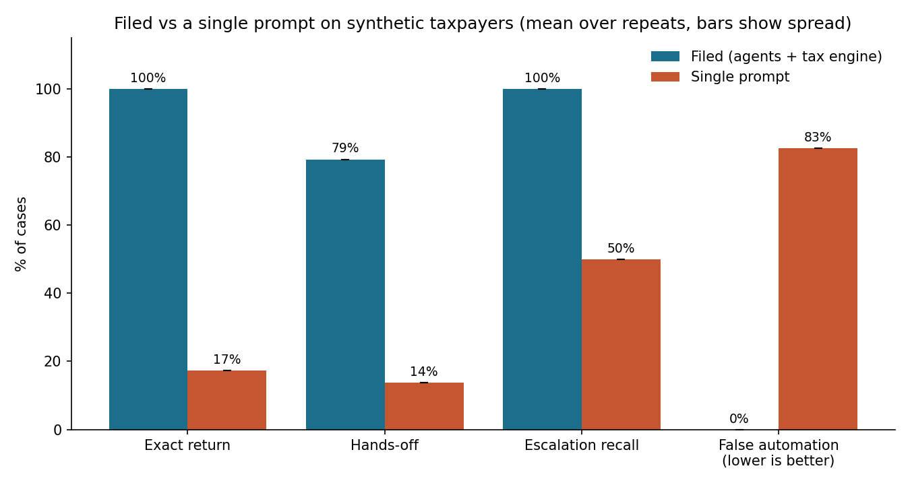

# Held-out set (never used during development), model reviewer off

Model: `gemini-3.5-flash-lite`. Model reviewer: off. Cases: 29 synthetic taxpayers. Complete repeats: {'filed': 1, 'baseline': 1}. Run date: 2026-11-22.
Every number below comes from `runs/`; nothing is estimated. Values are mean ± standard deviation across repeats.

## Headline

| Metric | Filed (agents + tax engine) | Single prompt |
|---|---|---|
| Exact return (form, regime, tax within Rs 10) | 100.0% | 17.4% |
| ITR form correct | 100.0% | 56.5% |
| Regime choice correct | 100.0% | 69.6% |
| Mean absolute tax error, Rs | 0 | 31,769 |
| Escalation recall (cases needing a person that were escalated) | 100.0% | 50.0% |
| Escalation precision (escalations that were needed) | 100.0% | 50.0% |
| False-automation rate (marked ready but wrong; lower is better) | 0.0% | 82.6% |
| Hands-off rate (finished correctly with no person) | 79.3% | 13.8% |
| Tokens per case | 1,193 | 1,048 |
| Seconds per case | 10 | 4 |

## By trap

Each cell is how many times the trap was handled correctly out of how many times it appeared (all repeats pooled).
Handled means: escalated to a person when one is needed, otherwise an exact return.

| Trap | Filed (agents + tax engine) | Single prompt |
|---|---|---|
| AIS_INTEREST_MISSING | 3/3 | 1/3 |
| BELATED_FORCED_NEW | 1/1 | 0/1 |
| CG_NEEDS_ITR2 | 1/1 | 0/1 |
| DIVIDEND_UNREPORTED | 2/2 | 0/2 |
| DUPLICATE_DOCUMENT | 3/3 | 1/3 |
| FOREIGN_RSU | 1/1 | 0/1 |
| HRA_NO_LANDLORD_PAN | 1/1 | 1/1 |
| INCOME_OVER_50L | 2/2 | 0/2 |
| LTCG_SMALL | 1/1 | 0/1 |
| OLD_REGIME_CHEAPER | 1/1 | 0/1 |
| PARENTS_SENIOR_80D | 1/1 | 0/1 |
| TDS_MISMATCH | 1/1 | 0/1 |
| TWO_EMPLOYERS | 3/3 | 0/3 |
| UNEXPLAINED_SFT | 1/1 | 1/1 |
| VDA_TRADES | 1/1 | 1/1 |

## Where Filed failed

- none in the repeats that were run

## How to read this

- Cases and answers are synthetic. The correct answer for each case comes from our tax engine applied to the true facts; the engine itself is checked by hand-worked tests (`tests/test_engine.py`). So this benchmark measures reading, reconciling and deciding, not the engine.
- The single-prompt baseline gets the same documents and the same model but no tax engine, no reconciliation step and no escalation rules.
- Repeats use temperature 0, so they mostly measure the provider's run-to-run variation rather than sampling noise.
- A case is "exact" only if the form, the regime and the final amount (within Rs 10) are all right.
