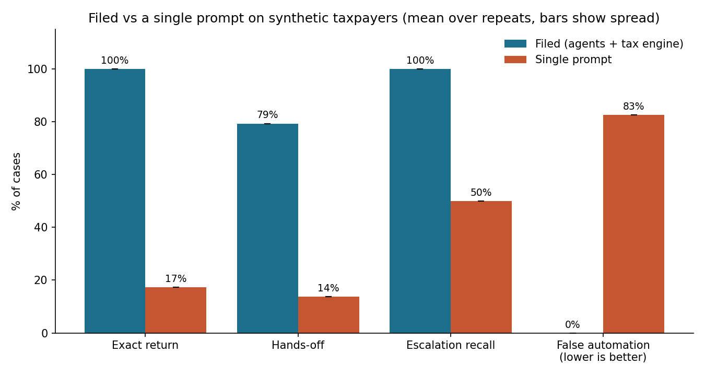

# Benchmark results

Model for every run: `gemini-3.5-flash-lite` (free tier), temperature 0. One repeat each, so there is no spread to report.
Dev set: 50 synthetic taxpayers (seed 7), used while building the system.
Held-out set: 29 synthetic taxpayers (seed 99), never looked at before the final configuration was fixed. The run was stopped early, so only the first 29 of its 50 cases were scored.
Every number comes from the saved runs in `runs/`; this file is generated by `python -m bench.overview`.

| Metric | Filed, reviewer can block (dev set) | Filed, reviewer off (dev set) | Single prompt (dev set) | Filed, reviewer off (held-out) | Single prompt (held-out) |
|---|---|---|---|---|---|
| Exact return (form, regime and tax within Rs 10) | 100.0% | 100.0% | 15.0% | 100.0% | 17.4% |
| Hands-off rate (finished correctly, no person) | 16.0% | 80.0% | 12.0% | 79.3% | 13.8% |
| False-automation rate (marked ready but wrong; lower is better) | 0.0% | 0.0% | 86.4% | 0.0% | 82.6% |
| Escalation recall (cases needing a person that were escalated) | 100.0% | 100.0% | 50.0% | 100.0% | 50.0% |
| Escalation precision (escalations that were needed) | 23.8% | 100.0% | 83.3% | 100.0% | 50.0% |
| Regime choice correct | 100.0% | 100.0% | 72.5% | 100.0% | 69.6% |
| Mean absolute tax error, Rs | 0 | 0 | 21,484 | 0 | 31,769 |
| Tokens per case | 1,802 | 1,161 | 1,042 | 1,193 | 1,048 |

## What the numbers say

- **The agents beat a single prompt by a wide margin.** On both sets Filed gets every return exactly right and never marks a wrong return as ready; the single prompt gets about one in six exactly right and marks most wrong returns as ready. The main reason is not reading ability but that the tax arithmetic, the regime comparison and the reconciliation rules are code, not model output.
- **Our first configuration over-escalated, and we changed it.** In the first run (column 1) a model reviewer could send a case to the expert. It sent 32 of the 40 cases that needed no person to the expert. Every objection we read was wrong, for example objecting to 80C claims "under the new regime" although the engine already ignores them there (we read a handful, not all 32). Hands-off rate was 16% and escalation precision 24%. The reviewer is now off by default (column 2 replays the same saved model answers without it: hands-off 80%, precision 100%, nothing else changed). Column 4 is the check on cases not used for that decision.
- **Remaining escalations are intended.** The cases that still go to the expert are the ten per 50 that the generator marks as needing a person (missing landlord PAN, unexplained property purchase, income above Rs 50 lakh, foreign RSUs, crypto).

## Per-run reports

- [Dev set, reviewer can block](dev_reviewer_gate/results.md)
- [Dev set, reviewer off (replay)](dev_reviewer_off/results.md)
- [Held-out set, reviewer off](heldout/results.md)

## Limits you should read before trusting this

- The documents are synthetic and machine-generated, three layouts with clean text. A model reading them is an easy task; real scans, photos and unusual layouts are untested, so reading accuracy on real documents may be much lower.
- The correct answers come from our own tax engine applied to the true facts, so this measures reading, reconciling and deciding, not tax law. The engine is checked by hand-worked tests, not yet by the official calculator.
- One repeat per run: the free Gemini tier allows only 15 requests a minute and a daily cap, and the 3-repeat plan was cut short. Run-to-run variation is not measured.
- The held-out run covers 29 cases, not 50, so its per-trap counts are small (see its report).
- Changing the reviewer after seeing dev-set results is a design decision informed by that data; the held-out column is there so you can see it holds on other cases.
